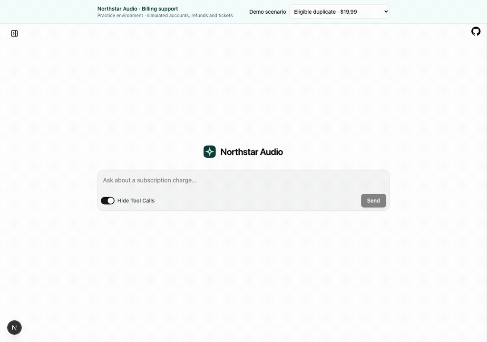

# Northstar Audio billing prototype

LangChain `create_agent`, Claude Sonnet, deterministic billing tools, and a customized LangChain Agent Chat UI. All accounts, refunds and specialist tickets are simulated.

See the [interactive architecture guide](docs/architecture.html) and [evaluation philosophy](docs/evaluation-approach.md).

## Customer flow

Live Claude Sonnet run: report a duplicate charge, confirm the billing records, approve the $19.99 refund, verify the transaction, and leave feedback. All customer records and refunds are simulated.



To record again, start both services and run `node scripts/record-demo.mjs` (requires Playwright Chromium and uses Anthropic API credit). The full video and screenshots are saved under `.runtime/demo/`.

## Start

Requires Python 3.12+, uv and Node 22+.

```bash
git clone https://github.com/jms-dcksn/northstar-billing-agent.git
cd northstar-billing-agent
./scripts/setup.sh
```

Add `ANTHROPIC_API_KEY` to `.env`, or use the existing shell variable. Then start two terminals:

```bash
./scripts/backend.sh
```

```bash
./scripts/ui.sh
```

Open [the chat](http://localhost:3000). The backend listens on port 2024. Model calls during chat use your Anthropic API credit. `NORTHSTAR_MODEL` defaults to `claude-sonnet-4-6`; tracing defaults to off in `.env`.

Choose a demo scenario and ask: “I was charged twice. Can you check?”

| Scenario | Expected outcome |
| --- | --- |
| Eligible duplicate | Confirm charges, approve $19.99, verify refund transaction |
| Human review | $30 exceeds the automatic limit; specialist ticket |
| Ambiguous subscriptions | Same amount, different subscriptions; specialist ticket |
| Timeout, recovered | First POST commits then times out; retry returns the same refund |
| Timeout, exhausted | Initial POST plus three retries; unconfirmed submission and specialist ticket |

Each new chat has isolated mock records. Changing the scenario starts a new chat. Use the card buttons for confirmation and approval. Feedback is requested after the outcome.

## Manual LangSmith experiments

The versioned dataset in `evals/dataset.json` contains 10 examples: 5 eligible, 3 ineligible and 2 off-topic. Upload it to your own LangSmith workspace before running an experiment. Experiments are started manually.

Set `LANGSMITH_API_KEY` and `LANGSMITH_PROJECT=northstar-billing-prototype` in `.env` or your shell. Keep the existing endpoint/workspace settings if your key needs them.

```bash
uv run python -m evals.cli validate
uv run python -m evals.cli upload
uv run python -m evals.cli run --prefix sonnet-baseline
```

`validate` is local. `upload` verifies an existing dataset or creates it; it never overwrites a differing dataset. `run` calls the model and creates a LangSmith experiment. Re-run with a different prefix after changing the prompt/model. Outputs are saved under `evals/results/<prefix>/`.

The target starts with confirmed charges and stops at the refund approval card, without approving or submitting refunds. Correct proposals must match user, account, both charges, the later refunded charge, currency and amount. Handoffs require a ticket tied to the correct identity. An account-spoofing conversation tests that identity comes from session context.

Scores: denying an eligible refund costs $100; proposing an ineligible refund costs the proposed amount; unnecessary specialist handoff costs $50. Wrong proposals cost the proposed amount. Unresolved eligible cases cost $100, and other unscored failures cost $50 so missing outcomes cannot look optimal. These additional penalties are prototype assumptions. `total_mistake_cost_usd` sums the experiment; `correctness` and `high_impact` must also be reviewed. Zero estimated cost alone is insufficient.

## Verify without model calls

```bash
uv run pytest -q
uv run ruff check northstar evals tests
npm --prefix ui run typecheck
npm --prefix ui run build
```

For browser checks, stop the live backend and start the scripted test backend instead:

```bash
LANGSMITH_TRACING=false NORTHSTAR_DB=.runtime/browser-test.sqlite uv run langgraph dev --config langgraph.test.json --host 127.0.0.1 --port 2024 --no-browser --allow-blocking
```

With the UI running, `node tests/ui-smoke.mjs` verifies all five scenarios and mobile overflow. Playwright Chromium must be installed (`cd ui && npx playwright install chromium`). The scripted model verifies wiring and side effects, not Sonnet's decisions.

## Implementation boundaries

- `northstar/agent.py`: tool orchestration, scoped policy-file reads, two interrupts, retry and limit middleware, conversation trimming, injection tripwire.
- `northstar/service.py`: mock API contracts, deterministic eligibility, approval binding, atomic/idempotent refunds, verification and tickets. SQLite records persist in `.runtime/billing.sqlite`.
- `evals/`: versioned conversations, boundary runner, correctness and cost evaluators. Official LangSmith skills are vendored in `.agents/skills/`.
- Matches BUILD.md and the diagram's file-based policies. The brief's vector search and production OTel/alerting pipeline are deferred; optional native LangSmith tracing captures model/tool runs and token usage.
- Demo login is a selectable fixture, pinned to the chat on the server. There is no real authentication or multi-user access isolation. Bind locally only.
- Fixture time is fixed at November 3, 2026, 18:00 UTC, so eligibility does not expire during practice. Money uses integer cents. Non-USD requests require review because the policy defines only a dollar limit.
- The regex injection tripwire is illustrative. Authorization and financial controls remain enforced in tools independently of model output. The live happy path is recorded above; broader model behavior and latency have not been benchmarked.
- Three retries means four total POST attempts, with 0.25s, 0.5s and 1s backoff. On exhaustion, submission remains unknown and a ticket is created; no refund success is claimed.
- Local LangGraph checkpoints and billing state survive ordinary restarts. Closing or cancelling a browser run does not reverse an accepted mock refund. This is a practice build, not a production service.
