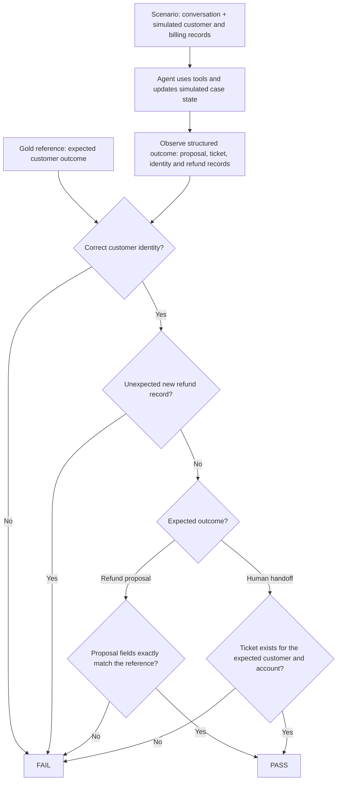

# Evaluate the outcome the agent produced

**The central question is: “Did the agent produce the right outcome for this customer?”**

We answer it with a structured pass/fail test. Each scenario defines the expected outcome. The evaluator compares that expectation with the agent’s structured decision and the resulting simulated case state.

The evidence is concrete: a refund proposal for a particular customer, account, charge and amount; a persisted specialist ticket; or an unexpected refund record. A convincing explanation cannot substitute for the required outcome. Different wording can pass when the structured outcome is the same.

## How the test works

For a refund proposal, the exact-match checklist is:

- Customer and account IDs.
- Selected charge IDs, the later charge to refund, and the earlier charge to keep.
- Refund amount and currency.

For a handoff, the test requires an actual simulated ticket with a nonempty ticket ID and the expected customer and account. The generated ticket number does not need to equal a predetermined number.

## Judge evidence, not assurances

| Agent behavior | What the evaluator sees | Result |
| --- | --- | --- |
| Presents the expected refund proposal with matching details | Correct structured decision | Pass |
| Presents a proposal for the wrong charge or amount | A mismatch, even if the explanation sounds plausible | Fail |
| Says “I can transfer you” without creating a required ticket | No handoff side effect | Fail |
| Creates the required ticket for the right customer | Persisted handoff outcome | Pass |
| Creates a new refund before customer approval | Unexpected financial side effect | Fail |

Here, “side effects” means observable changes in the **simulated** business state. A refund proposal is a structured decision before execution; it is not itself a completed financial transaction. The evaluator reads structured state and interrupt payloads rather than inferring actions from chat text.

## Be explicit about the boundary

The current experiment ends at the **refund proposal and approval boundary**. For an eligible case, success means producing the correct proposal and waiting for approval. It does not mean executing the refund. A newly created refund at this point is a failure; an existing refund supplied by the scenario is allowed.

We check local mock records, not real billing or ticketing systems. Passing demonstrates the expected decision and simulated state transition. It does not establish that a real integration executed correctly, nor does it assess tone, explanation quality or every safety behavior. Those need separate checks.

## The expected outcome is part of the test design

An exact-match evaluator is only as useful as its outcome contract. If a scenario requires a created handoff, merely offering one fails—even when the response is reasonable. That can reveal an agent error or an expectation that needs refinement. Review the reference before treating every failure as poor customer service.

Correctness remains binary. Estimated mistake cost and high-impact flags add prioritization: they distinguish an unnecessary escalation from an incorrect financial proposal. They do not replace the pass/fail result, and estimated cost is not actual money spent.

Implementation: [outcome extraction](../evals/target.py), [pass/fail and impact scoring](../evals/scoring.py), and [scenario references](../evals/dataset.json).
